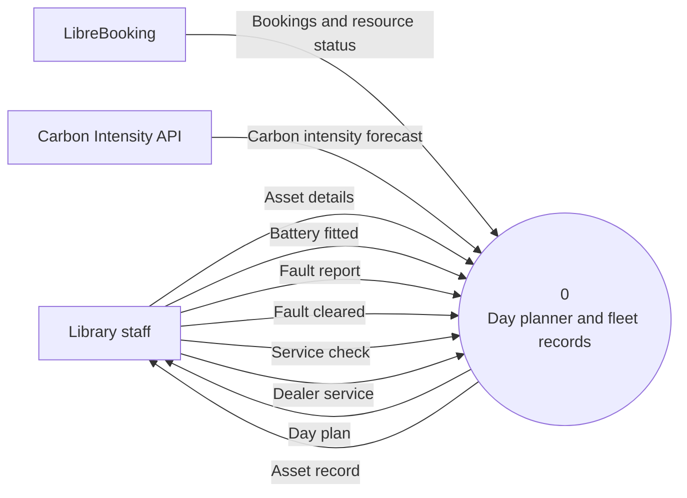
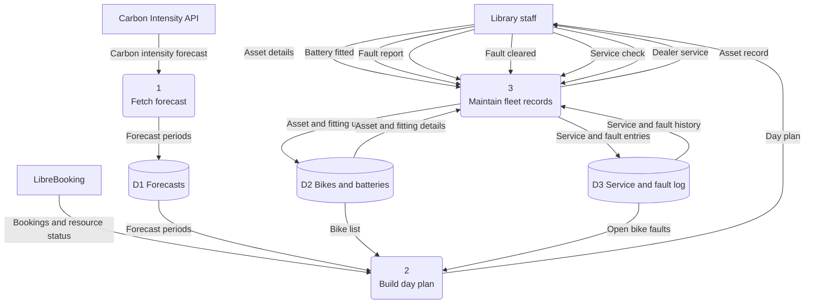
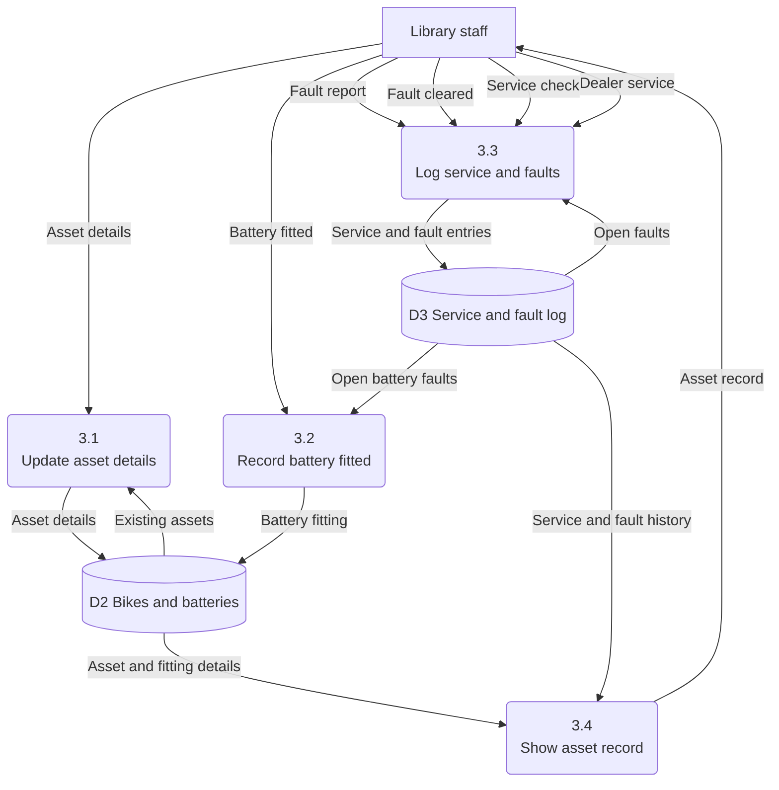

# Data flow diagrams – Day planner and fleet records

**Project:** Community e-bike library – day planner and fleet records (proof of concept)
**Document:** `docs/analysis/dfds.md`
**Status:** v0.9 (12 November 2026, after baselining the CRP script: bike state rule 4 refined by DEC-30. v0.8: DEC-23 and DEC-24; §8 open points updated for DEC-27). References to other documents updated 12 November 2026; no change to the analysis
**Method:** SSADM required system, logical view: context diagram, level 1 and one level 2, with balancing
**Related:** `docs/analysis/workshop-1/notes.md` (assumptions register §7), `docs/analysis/decision-log.md` v1.5, `docs/analysis/data-dictionary.md` v0.6, `docs/analysis/normalisation.md` v0.3, `docs/prd.md` v0.8, `docs/crp-script.md` v1.3, `docs/technical-note.md` v0.8, `diagrams/dfd/*.mmd`. Earlier working documents (discovery session, grill log) are kept in the project, not the repository

> **Fictional example.** The organisation, its people and the assumptions marked **(invented)** are made up for an article and demo.

---

## 1. Scope

The tool does two things for library staff:

1. **Day planner.** For each half hour of the staffed day (07:00–16:30), it shows each bike's state, its next booking (even if that's on the next staffed day), any open fault, and the forecast carbon intensity band. Staff decide for themselves when to charge.
2. **Fleet records.** Staff look up and update bikes and batteries, which battery is where, service history and faults. This replaces the four spreadsheets.

**Out of scope:** charge plans, charging recommendations, charge times, battery charge levels, recording charge sessions, reporting carbon saved, battery compatibility checks, asset retirement, role-based permissions, and attaching documents. Members, bookings, payments, check-out, check-in and bike availability stay in LibreBooking, which the tool only reads (DEC-01, DEC-18).

**Changes from v0.8 (CRP script):**

- **Bike state rules 3 and 4 read "not checked in" against the slot's end (DEC-30).** After a late check-in, the slots between the due time and the check-in still read overdue. No flow or diagram changes.

**Changes from v0.7 (PRD drafting):**

- **Bike state rule 4 refined (DEC-23).** A bike is overdue only once its due time has passed. Until then, slots after its reservation ends fall through to rule 5 (in the workshop).
- **Bookings and resource status also carries earlier reservations (DEC-24):** any reservation that started before today and is still running or not checked in. Same flow name, same composition; only the selection widens.
- **Demo set-up (DEC-26)** adds a demo clock and recorded forecasts. These are physical, so the logical DFDs don't change.
- **No diagram changes.** Every flow keeps its name, so the Mermaid files and the balancing at every level are unchanged.

**Changes in v0.7 (workshop 1):**

- **New flow, D3 → 2 Open bike faults.** The day plan flags bikes with an open fault without changing their state (DEC-02 refined).
- **New flow, D3 → 3.2 Open battery faults.** Fitting a quarantined battery shows a warning but isn't blocked (DEC-06 refined).
- **New flow, D2 → 3.1 Existing assets.** This fills the edit screen and suggests the next free asset tag (REQ-18). It resolves MM-04.
- **Flows renamed so each name has one composition (MM-03).** At level 1, 3 → D2 is now Asset and fitting updates and D2 → 3 is Asset and fitting details. At level 2, D2 → 3.4 is Asset and fitting details.
- **Process 2 changes.** It works in half-hour slots (DEC-15), applies the revised bike state rule (DEC-16), and shows each bike's next booking (DEC-17). Bookings and resource status now covers reservations up to the next staffed day.
- **Battery fitted can have no bike.** This means "removed" (DEC-20). Battery location (fitted, on the shelf or quarantined) is derived by 3.4.
- **Who and when.** Staff input flows carry the name picked on the device. Processes stamp Recorded at and Last updated at (DEC-19).
- **§7 rewritten** with data dictionary names. It resolves MM-01, MM-02, MM-06 and MM-07.
- **Level 0 unchanged.** The ten boundary flows keep their names.

Earlier changes (v0.2 to v0.6) are summarised in the decision log: DEC-01 to DEC-14.

---

## 2. Assumptions and decisions affecting the DFDs

Assumption IDs refer to the register in `docs/analysis/workshop-1/notes.md` §7. Decisions are in `docs/analysis/decision-log.md`.

| ID | Statement | Effect on the DFDs |
|----|-----------|--------------------|
| DEC-01 | LibreBooking is the master for bike availability. Resource status "hidden" counts as out of service | LibreBooking → 2 carries **Bookings and resource status**. D2 → 2 carries the **Bike list**. There's no status in D2, and nothing flows into LibreBooking |
| DEC-02 | An open fault doesn't change a bike's state; the day plan flags it | **D3 → 2 Open bike faults** |
| DEC-03 | Whoever fixes a fault closes it, including through a dealer service | **Fault cleared**; **Dealer service** may close faults; **D3 → 3.3 Open faults** |
| DEC-06 | No compatibility or duplicate-fitting check. A quarantined battery triggers a warning, not a block | **D3 → 3.2 Open battery faults**; no D2 → 3.2 read |
| DEC-07 | A battery's cycle count is one value, updated through 3.1 | Carried in **Asset details**. The dealer service screen sends cycle counts to 3.1 and the service to 3.3; there's no flow from 3.3 to D2 |
| DEC-08 | Charge times aren't held | Battery type holds capacity only |
| DEC-09 | Quarantine is an open fault against a battery; there's no retirement | No status field; no delete flow |
| DEC-11, DEC-12 | Everyone can edit everything; one Library staff entity | No permission rules; ten boundary flows |
| DEC-13, DEC-14 | Period end and fault status are derived | D1 holds period start only; D3 holds cleared date and cleared by only |
| DEC-15 | Half-hourly day plan; layout follows the screen | 19 slots. The layout is physical design, not a DFD matter |
| DEC-16, DEC-23, DEC-30 | Bike state rule; overdue only once the due time has passed; "not checked in" read against the slot's end | Process 2 business rule (§5) |
| DEC-17, DEC-24 | Each bike's next booking, up to the next staffed day; also earlier reservations still running or not checked in | **Bookings and resource status** covers today, the next staffed day, and earlier reservations still running or not checked in |
| DEC-18 | LibreBooking is the only check-out and check-in | No check-out flow; **Battery fitted** only when a battery moves |
| DEC-19 | A name is picked once and remembered; stamps on records | Recorded by or Last updated by on input flows; processes stamp the time |
| DEC-20 | Battery location is derived; Remove battery is a fitting with no bike | **Battery fitted**: bike optional. 3.4 derives location |
| DEC-21 | Print button and last loaded plan kept on the phone | Physical form of the **Day plan**; no change to the logical DFDs |
| DEC-22 | One-off import of current assets and the last year | Migration, not a process on the required system DFDs |
| DEC-26 | Demo clock and recorded forecasts for the scenario dates | Demo set-up, not part of the required system; no change to the logical DFDs |
| ASM-02 | The API lists reservations with check-in times, and each resource's status | Source of **Bookings and resource status** (confirmed by Lewis; earlier reservations to confirm, A-05) |
| ASM-04 | Staffed 07:00–16:30 on weekdays | No settings store; the hours, and so "next staffed day", are in process 2's logic |
| ASM-10 | Retiring an asset is an admin task outside the tool | No delete flow from 3.1 |

---

## 3. Notation

The diagrams render in Britton and Doake's notation in the viewer: ovals for external entities, numbered process boxes, open-ended data stores and a dashed boundary. In the raw Mermaid files these are rectangles, rounded boxes and cylinders. Data only moves between entities and stores through a process. Enquiry triggers (a member of staff opening the day plan or looking up a bike) aren't drawn.

**Library staff** covers the coordinator, volunteers and the volunteer mechanic. They exchange the same data with the tool, so they're one role (DEC-12). The dealer is outside the boundary: staff key in each dealer service from the job sheet.

---

## 4. Level 0 – context diagram

---

## 5. Level 1

| ID | Process | Trigger | What it does |
|----|---------|---------|--------------|
| 1 | Fetch forecast | Every 30 minutes | Reads the regional carbon intensity forecast for the depot's postcode and stores it by half hour |
| 2 | Build day plan | A member of staff opens the day planner | Combines reservations up to the next staffed day, earlier reservations still running or not checked in (DEC-24), check-ins and each bike's availability from LibreBooking with the bike list, open bike faults and the forecast. Produces a half-hourly view of the staffed day |
| 3 | Maintain fleet records | A member of staff adds, updates or looks up a record | Keeps bike, battery and battery type details, battery fittings and removals, service checks, dealer services and faults (reported and cleared). Shows a bike's or battery's full record |

### Process 2 business rules

**Bike state (DEC-16; rule 4 refined by DEC-23; rules 3 and 4 read against the slot's end, DEC-30).** For each bike in the bike list and each half-hour slot, apply the first rule that matches:

| # | State | Rule |
|---|-------|------|
| 1 | Out of service | The bike's resource is unavailable or hidden in LibreBooking |
| 2 | In the workshop | A reservation covers the slot or has ended, and the bike was checked in against it at or before the slot's end |
| 3 | Out on loan | A reservation covers the slot and the bike wasn't checked in against it by the slot's end |
| 4 | Overdue – not checked in | The latest reservation ended before now and the bike wasn't checked in against it by the slot's end. The due time (reservation end) is shown, with its day if it's earlier than today. After a late check-in, the slots between the due time and the check-in still read overdue (DEC-30) |
| 5 | In the workshop | None of the above. This includes slots after a reservation that hasn't reached its due time yet: the bike is assumed back on time (DEC-23) |

The rule uses the latest reservation that started at or before the slot, including reservations that started before today (DEC-24). A reservation covers a slot if it starts before the slot ends and ends after the slot starts. If an overdue bike's next reservation has already started, rule 3 applies and REQ-15 warns staff (data dictionary OI-17).

**Per bike:**
- **Next booking:** the start of the bike's earliest reservation that hasn't started yet, today or on the next staffed day. It's blank if there isn't one.
- **Open fault flag:** shown if the bike has an open fault in D3. It doesn't change the bike's state.
- **Rebooked while overdue:** shown if the bike is overdue now and has another reservation later today (REQ-15).

**Per slot:** the forecast band as text and colour. If the slot has no forecast, it shows "No forecast".

**"Now"** is the system clock. In the demo it's the stand-in's demo clock (DEC-26), which also sets the plan date.

**Balancing against level 0:** all ten boundary flows appear with the same entity and direction. Bookings and resource status and Day plan belong to process 2; Carbon intensity forecast to process 1; and Asset details, Battery fitted, Fault report, Fault cleared, Service check, Dealer service and Asset record to process 3. D1 to D3 are internal, including the D3 → 2 read. Balancing holds. DEC-24 widens which reservations Bookings and resource status selects, not its composition, so balancing is unaffected.

---

## 6. Level 2 – process 3, Maintain fleet records

| ID | Process | What it does |
|----|---------|--------------|
| 3.1 | Update asset details | Adds bikes, batteries and battery types, and edits their details, including a battery's cycle count after a dealer service. Reads existing assets to fill the edit screen and suggest the next free asset tag. Stamps Last updated by and Last updated at on bikes and batteries. It doesn't set availability (DEC-01) or retire assets (ASM-10) |
| 3.2 | Record battery fitted | Records a battery fitted to a bike, or removed with no replacement (DEC-20), with Recorded by and Recorded at. It can be started from the bike or the battery. If the battery has an open fault (quarantined), it shows a warning but saves if staff confirm (DEC-06). There's no compatibility check |
| 3.3 | Log service and faults | Records service checks, fault reports (against a bike or a battery), cleared faults and dealer services, which may also clear faults. Stamps Recorded at. Reads open faults (no cleared date, DEC-14) to find the one being cleared |
| 3.4 | Show asset record | Shows one bike or battery. The last service and the current battery (or battery location) come first, then the history, newest first. Derives each fault's status (DEC-14) and the battery's location (DEC-20) |

**Battery location rule (DEC-20), applied by 3.4:**

| # | Location | Rule |
|---|----------|------|
| 1 | Quarantined | The battery has an open fault |
| 2 | Fitted to <bike> | The battery's latest fitting names a bike, and that bike has no later fitting |
| 3 | On the shelf | Otherwise: the battery was removed, another battery was fitted to its bike later, or it's never been fitted |

A bike's current battery is the battery of the bike's latest fitting, but only if that fitting is also the battery's latest. Otherwise the bike has no battery fitted.

**Balancing against process 3 at level 1:**

| Level 1 flow | Level 2 |
|--------------|---------|
| Asset details (Library staff →) | → 3.1 |
| Battery fitted (Library staff →) | → 3.2 |
| Fault report, Fault cleared, Service check, Dealer service (Library staff →) | → 3.3 |
| Asset record (→ Library staff) | from 3.4 |
| Asset and fitting updates (→ D2) | Split: Asset details from 3.1; Battery fitting from 3.2 |
| Service and fault entries (→ D3) | from 3.3 |
| Asset and fitting details (D2 →) | Split: Existing assets → 3.1; Asset and fitting details → 3.4 |
| Service and fault history (D3 →) | Split: Open faults → 3.3; Open battery faults → 3.2; Service and fault history → 3.4 |

Balancing holds. Each split is documented in the data dictionary (§4).

---

## 7. Data stores and external flows

Element definitions, formats and flow compositions are in `docs/analysis/data-dictionary.md` v0.6. Names here match the dictionary.

| Store | Main data items | Written by | Read by |
|-------|-----------------|------------|---------|
| D1 Forecasts | Region, Period start, Forecast intensity (gCO2/kWh), Index band, Retrieved at. Period end isn't stored (DEC-13) | 1 | 2 |
| D2 Bikes and batteries | **Bike:** Bike asset tag, LibreBooking resource ID, Make, Model, Frame size, Bike serial number, Bike purchase date, Last updated by, Last updated at. **Battery:** Battery asset tag, Battery type, Bosch serial, Battery purchase date, Cycle count (latest, no history), Last updated by, Last updated at. **Battery type:** Battery type, Capacity (Wh). **Fitting:** Battery asset tag, Fitted from, Bike asset tag (blank if removed), Recorded by, Recorded at | 3.1, 3.2 | 2, 3.1, 3.4 |
| D3 Service and fault log | Entry ID, Entry type (service check, dealer service or fault), Entry date, Bike asset tag or Battery asset tag, Description, Recorded by, Recorded at; for faults, Cleared date and Cleared by. A fault is open while Cleared date is blank; Fault status isn't stored (DEC-14) | 3.3 | 2, 3.2, 3.3, 3.4 |

| External flow | Main data items |
|---------------|-----------------|
| Bookings and resource status (LibreBooking → 2) | Per reservation, for today and the next staffed day, plus earlier reservations still running or not checked in (DEC-24): LibreBooking resource ID, Reservation start, Reservation end, Checked in at (if any). Per resource: LibreBooking resource ID, Resource status (available, unavailable or hidden) |
| Carbon intensity forecast (Carbon Intensity API → 1) | Region; half-hour periods with Period start, Period end, Forecast intensity and Index band |
| Day plan (2 → Library staff) | Plan date; per slot: Slot start, Index band, and each bike's Bike state (with the due time when overdue); per bike: Next booking, Open fault flag, Rebooked while overdue |
| Asset record (3.4 → Library staff) | Bike or battery details with Last updated by and Last updated at; current fitting or Battery location; Quarantined; service and fault history with Fault status |

**Notes for normalisation:** the four spreadsheets name the same bike differently ("M07", "Motus 7", "Grand Tour 7"); D2 resolves this with one asset tag mapped to the LibreBooking resource ID. D3 replaces the service log's one-tab-per-year repeating group. The fleet register's status column and the battery register's charge times tab aren't carried over (DEC-01, DEC-08). The cycle count stays on the battery by choice (DEC-07). Period end, Fault status, Battery location, Next booking and the day plan flags are derived, not stored. "Recorded by", "Cleared by" and "Last updated by" are free-text names, because there's no staff store (DEC-19). The full analysis is in `docs/analysis/normalisation.md`.

---

## 8. Open points

- **Lewis (A-05), before go-live:** the exact API endpoints for reservations up to the next staffed day, earlier reservations still running or not checked in (DEC-24), check-in times and resource status. The demo's stand-in synthesises this data meanwhile (DEC-27).
- **Data dictionary OI-17:** an overdue bike whose next reservation has already started shows as out on loan; REQ-15 covers it with a warning.
- **Physical design, not on the DFDs:** the phone and tablet layouts (DEC-15), the print button and the offline copy (DEC-21), the remembered name on the device (DEC-19), and the demo clock and recorded forecasts (DEC-26). How these are built is in the technical note.
