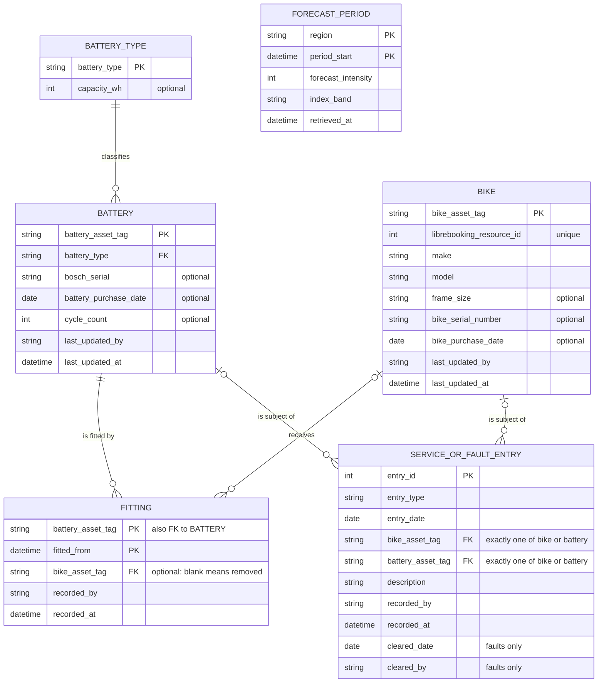

# Normalisation – Day planner and fleet records

**Project:** Community e-bike library – day planner and fleet records (proof of concept)
**Document:** `docs/analysis/normalisation.md`
**Status:** v0.3 (12 November 2026, after workshop 1: attributes from DEC-19 and DEC-20 added; new derived items). References to other documents updated and NI-10 closed by DEC-36, 12 November 2026; no change to the relations
**Method:** SSADM relational data analysis: each source taken from UNF to 1NF, 2NF and 3NF, then rationalised into one set of 3NF relations and checked against the data dictionary
**Related:** `docs/analysis/data-dictionary.md` v0.6, `docs/analysis/dfds.md` v0.9 and `diagrams/dfd/*.mmd`, `docs/analysis/decision-log.md` v1.5, `docs/analysis/workshop-1/notes.md`, `docs/prd.md` v0.8, `docs/technical-note.md` v0.8, `diagrams/lds/logical-data-structure.mmd` v0.2. The discovery session, which describes the spreadsheets, is kept in the project, not the repository

> **Fictional example.** The organisation, its people and its spreadsheets are invented for an article and demo. The extracts in section 2 are **(invented)**. They follow the column headings in the discovery session and show the issues in the data dictionary (§6). Replace them with the real extracts and repeat the analysis.

**Changes from v0.2 (workshop 1):**

- **Added from the workshop (§7.4):**
  - Last updated by and Last updated at on Bike and Battery
  - Recorded at on entries
  - Recorded by and Recorded at on Fitting (DEC-19)
- **Fitting's Bike asset tag becomes optional (DEC-20).** A fitting with no bike records a removal.
- **New derived items (§7.5):** Battery location, Bike state, Next booking and the day plan flags. None is stored.
- **Updated:** §8 relations, the 3NF check and the logical data structure (v0.2), plus the §10 import rules.
- **Fleet confirmed as 18 bikes and 26 batteries (ASM-01).** The invented extracts still include a donated bike; see data dictionary OI-16.

---

## 1. Approach and notation

1. Take each spreadsheet as a separate source. List its attributes in unnormalised form (UNF), with level numbers for repeating groups, and choose a key.
2. **1NF:** remove repeating groups into their own relations, each taking the key of its parent. Split cells that hold more than one fact.
3. **2NF:** remove partial dependencies: attributes that depend on only part of a compound key.
4. **3NF:** remove transitive dependencies: attributes that depend on another non-key attribute.
5. **Rationalise:** resolve synonyms and homonyms, merge relations with the same key, apply the scope decisions (DEC and ASM IDs), add what the DFDs need that no spreadsheet holds, and remove derived data.
6. Check the result against the data dictionary.

| Notation | Meaning |
|----------|---------|
| **Bold** | Part of the primary key |
| `*` after a name | Foreign key: refers to the key of another relation |
| Level 1, 2, 3 | UNF level: 2 repeats within 1, 3 repeats within 2 |

Test for 3NF: every non-key attribute depends on the key, the whole key and nothing but the key.

---

## 2. Source extracts (invented)

Dates are as typed in the spreadsheets.

### 2.1 Fleet register (one row per bike)

| Asset tag | Make | Model | Type | Motor | Battery | Frame | Serial no. | Purchased | Status |
|-----------|------|-------|------|-------|---------|-------|------------|-----------|--------|
| M01 | Raleigh | Motus Grand Tour | Hybrid | Bosch Active Line Plus | PowerTube 500 (500 Wh) | M | RL22-0047102 | 14/03/2023 | Available |
| M07 | Raleigh | Motus Grand Tour | Hybrid | Bosch Active Line Plus | PowerTube 500 (500 Wh) | L | RL22-0047316 | 14/03/2023 | Available |
| M10 | Raleigh | Motus | Hybrid | Bosch Active Line | PowerPack 400 (400 Wh) | M | RL19-0012884 | 02/05/2020 | In workshop |
| G02 | Tern | GSD Gen 3 (P10) | Longtail cargo | Bosch Cargo Line | PowerPack 500 (500 Wh) | One size | TRN-G3-55021 | 20/09/2024 | Unavailable – brakes |
| D01 | Unknown | Donated e-bike | Hybrid | Hub motor | Own 36 V | 19" | | Donated 2022 | Out of service |

The extract in the discovery session, with a quantity per model, is taken to be a summary of this sheet. That settles N-01 for the worked example: the register itself has one row per bike.

### 2.2 Battery register

**Batteries tab**

| Asset tag | Bosch serial | Capacity | Purchased | Notes |
|-----------|--------------|----------|-----------|-------|
| B-01 | 4471930015 | 500 Wh | 14/03/2023 | In M01 |
| B-09 | 4471931207 | 500 Wh | 14/03/2023 | In M04. SWOLLEN 12/6 – quarantined, don't use |
| B-10 | | 400 | 2020 | Old Motus. Only holds 2 bars? |
| B-16 | | 36V | Donated | Donated bike battery – own charger |
| B-17 | 4471932088 | 500Wh | 03/02/2025 | Spare (grant). 22 cycles Apr 26 |

**Charge times tab**

| Battery | Charger | To 50% | To 100% |
|---------|---------|-------:|--------:|
| PowerPack 400 | 4 A | 1.5 h | 3.5 h |
| PowerPack 400 | 2 A | | about 6 h |
| PowerPack/PowerTube 500 | 4 A | 2 h | 4.5 h |
| PowerPack/PowerTube 500 | 2 A | | 7 h |

### 2.3 Service log (2026 tab; the 2025 tab has the same columns)

| Date | Bike | Type | Work done | Battery cycles | Done by |
|------|------|------|-----------|----------------|---------|
| 20/01/2026 | Motus 7 | Full service | Full service and Bosch diagnostics | B-07 PowerTube 500: 287 | Dealer |
| 21/04/2026 | Motus 7 | Interim | Brake bleed, new chain | B-07 PowerTube 500: 301 | Dealer |
| 21/04/2026 | GSD 1 | Interim | Interim service; spare battery checked too | B-14 PowerPack 500: 156; B-17 PowerPack 500: 22 | Dealer |
| 11/06/2026 | All | Weekly check | M03 rear tyre low, pumped up; G02 chain lubed; rest OK | | Sam |
| 13/06/2026 | GSD 2 | Repair | New front brake pads | | Sam |

### 2.4 Fault log

| Date | Bike | Fault 1 | Fault 2 | Fault 3 |
|------|------|---------|---------|---------|
| 09/06/2026 | Grand Tour 7 | Rear light flickers | Bell missing | |
| 12/06/2026 | GSD2 | Front brake pads worn – FIXED 13/6 Sam | | |
| 12/06/2026 | M04 | Battery B-09 swollen – DO NOT CHARGE | | |
| 15/06/2026 | Motus 3 | Rear puncture – fixed same day (Aisha) | Kickstand loose | Mudguard rattles |
| 16/06/2026 | G-1 | Display shows error 503 | | |

The same bike appears as M07, "Motus 7" and "Grand Tour 7", and the same GSD as G02, "GSD 2" and "GSD2" (N-15).

---

## 3. Fleet register

### 3.1 UNF

| Level | Attribute | Note |
|-------|-----------|------|
| 1 | **Asset tag** | Key; unique in this sheet |
| 1 | Make | |
| 1 | Model | |
| 1 | Type | |
| 1 | Motor | |
| 1 | Battery | Battery type and capacity in one cell: not atomic |
| 1 | Frame size | |
| 1 | Serial number | |
| 1 | Purchase date | Typed as dd/mm/yyyy; "Donated 2022" isn't a date |
| 1 | Status | Status and reason in one cell ("Unavailable – brakes"): not atomic |

No repeating groups.

### 3.2 1NF to 3NF

| Stage | Relations | What changed and why |
|-------|-----------|----------------------|
| 1NF | Bike (**Asset tag**, Make, Model, Type, Motor, Standard battery type, Capacity, Frame size, Serial number, Purchase date, Status, Status reason) | Battery split into Standard battery type and Capacity; Status split into Status and Status reason. The battery column names the model's usual battery type, not the battery fitted, so it's renamed (N-04) |
| 2NF | No change | The key is a single attribute, so there can be no partial dependency |
| 3NF | Bike (**Asset tag**, Make\*, Model\*, Frame size, Serial number, Purchase date, Status, Status reason) | Type, Motor and Standard battery type depend on the model, not the bike: Asset tag → Model → Motor (N-02) |
| | Bike model (**Make**, **Model**, Type, Motor, Standard battery type\*) | Make and Model together identify a model |
| | Battery type (**Battery type**, Capacity) | Capacity depends on the battery type, not the model (N-05) |

---

## 4. Battery register

### 4.1 Batteries tab

**UNF**

| Level | Attribute | Note |
|-------|-----------|------|
| 1 | **Asset tag** | Key |
| 1 | Bosch serial | Blank for older batteries and the donated battery (N-08) |
| 1 | Capacity | "500 Wh", "400" and "500Wh" are typed differently; "36V" is a voltage, not a capacity |
| 1 | Purchase date | "2020" and "Donated" aren't dates |
| 1 | Notes | Several facts in one cell: the bike it's in, its condition, a cycle count with its date, and other remarks (N-07) |

**1NF to 3NF**

| Stage | Relations | What changed and why |
|-------|-----------|----------------------|
| 1NF | Battery (**Asset tag**, Bosch serial, Capacity, Purchase date, Fitted bike, Condition, Cycle count, Cycle count date, Other note) | Notes split into atomic attributes. Each battery has at most one of each in the extract, so there is no repeating group |
| 2NF | No change | Single-attribute key |
| 3NF | Battery (**Asset tag**, Bosch serial, Battery type\*, Purchase date, Fitted bike\*, Condition, Cycle count, Cycle count date, Other note) | Capacity depends on the battery type, which the sheet doesn't record (N-05). Battery type is added from the label to show the dependency |
| | Battery type (**Battery type**, Capacity) | Fitted bike refers to Bike |

The cycle count is really a reading taken at a service, so it depends on the battery and the date read. With only one reading held per battery, Asset tag → Cycle count holds in this sheet (N-09).

### 4.2 Charge times tab

**UNF**

| Level | Attribute | Note |
|-------|-----------|------|
| 1 | **Battery** | Key with Charger. "PowerPack/PowerTube 500" puts two battery types in one cell |
| 1 | **Charger** | |
| 2 | Target level | Repeats across the columns "To 50%" and "To 100%" |
| 2 | Duration | Blank where not known |

**1NF to 3NF**

| Stage | Relations | What changed and why |
|-------|-----------|----------------------|
| 1NF | Charge time (**Battery type**, **Charger**, **Target level**, Duration) | The combined cell is split into one row per battery type; the column repeating group becomes rows |
| 2NF | No change | Duration depends on all three key attributes |
| 3NF | No change | No transitive dependency |

This relation is in 3NF but is removed during rationalisation (DEC-08).

---

## 5. Service log

### 5.1 UNF

| Level | Attribute | Note |
|-------|-----------|------|
| 1 | **Log year** | The tab name; key at level 1 (N-10) |
| 2 | Entry date | |
| 2 | Entry type | "Full service", "Interim", "Weekly check", "Repair" |
| 2 | Work done | |
| 2 | Done by | A person, or "Dealer" |
| 3 | Bike name | Repeats when one row covers several bikes ("All" on a weekly check). Names vary (N-12, N-15) |
| 3 | Battery asset tag | Repeats: one dealer row can list several batteries (N-12) |
| 3 | Battery type | Typed next to the tag in the same cell |
| 3 | Cycle count | |

No attribute or combination identifies a row at level 2 reliably, so a surrogate **Entry ID** is introduced, as in the data dictionary (DI-021).

### 5.2 1NF to 3NF

| Stage | Relations | What changed and why |
|-------|-----------|----------------------|
| 1NF | Service entry (**Entry ID**, Entry date, Entry type, Work done, Done by) | Tabs combined. Log year dropped because it's derivable from Entry date |
| | Service entry bike (**Entry ID\***, **Bike name**) | Repeating group of bikes removed, taking the parent's key |
| | Battery reading (**Entry ID\***, **Battery asset tag**, Battery type, Cycle count) | Repeating group of batteries removed, taking the parent's key |
| 2NF | Battery reading (**Entry ID\***, **Battery asset tag\***, Cycle count) | Battery type depends on Battery asset tag alone, which is only part of the key: a partial dependency |
| | Battery (**Battery asset tag**, Battery type\*) | New relation for the partial dependency |
| 3NF | No change | No transitive dependency |

---

## 6. Fault log

### 6.1 UNF

| Level | Attribute | Note |
|-------|-----------|------|
| 1 | **Fault date** | Key with Bike name. Not reliable: two reports for one bike on one day would clash |
| 1 | **Bike name** | Names vary. Holds the bike even when the fault is the battery's |
| 2 | Fault no | Which of the Fault 1–3 columns it was typed in (N-14) |
| 2 | Fault description | Sometimes also holds a battery tag, "FIXED", a date and a name (N-13) |

### 6.2 1NF to 3NF

| Stage | Relations | What changed and why |
|-------|-----------|----------------------|
| 1NF | Fault report (**Fault date**, **Bike name**) | The outer row keeps its key; it has no other attributes |
| | Fault (**Fault date\***, **Bike name\***, **Fault no**, Fault description, Battery asset tag, Fault status, Cleared date, Cleared by) | Fault 1–3 columns removed as a repeating group. Description cells split into atomic attributes |
| 2NF | No change | Every non-key attribute of Fault depends on the whole key |
| 3NF | No change | No transitive dependency |

Fault no only records which column a fault was typed in. With the key also unreliable, rationalisation replaces the key with Entry ID.

---

## 7. Rationalisation

### 7.1 Synonyms and homonyms

| Names in the spreadsheets | Name in the data dictionary | Note |
|---------------------------|-----------------------------|------|
| Asset tag (fleet register); Bike (service log, fault log): "M07", "Motus 7", "Grand Tour 7" | Bike asset tag (DI-007) | Synonyms; mapped by hand at import |
| Asset tag (battery register); tag in Battery cycles | Battery asset tag (DI-014) | |
| Battery (fleet register); type in Battery cycles; implied by Capacity | Battery type (DI-016) | |
| Serial no. (fleet register) | Bike serial number (DI-012) | |
| Purchased (both registers) | Bike purchase date (DI-013), Battery purchase date (DI-017) | Homonym: same heading, different subject |
| Date (service log, fault log) | Entry date (DI-023) | |
| Work done; Fault description | Description (DI-024) | |
| Status (fleet register) | Not carried. Availability is Resource status in LibreBooking (DEC-01) | Homonym with fault status (N-16) |
| "FIXED …" in fault text | Fault status, Cleared date, Cleared by (DI-026 to DI-028) | |
| Done by | No direct equivalent; Recorded by (DI-025) is who made the entry | See NI-04 |

### 7.2 Merging relations with the same key

| 3NF relations from the sources | Merged into |
|--------------------------------|-------------|
| Bike (fleet register) | Bike |
| Battery (battery register); Battery (service log, from 2NF) | Battery |
| Battery type (fleet register, battery register) | Battery type |
| Service entry (service log); Fault (fault log) | Service or fault entry, key Entry ID. Entry type tells them apart |
| Service entry bike; Fault report | Absorbed. One entry per bike puts the bike on the entry; Fault report has no non-key attributes |

### 7.3 Scope and decisions

| Relation or attribute | Action | Reason |
|-----------------------|--------|--------|
| Bike: Status, Status reason | Removed | DEC-01: LibreBooking holds availability. The reason becomes a fault or service entry |
| Bike model: Type, Motor, Standard battery type | Removed. Make and Model stay on Bike | Not on the DFDs |
| Charge time | Removed | DEC-08 |
| Battery: Fitted bike | Replaced by Fitting (**Battery asset tag\***, **Fitted from**, Bike asset tag\*) | DFD D2 and process 3.2 |
| Battery: Condition | Becomes fault entries | DEC-09: an open fault against a battery is the quarantine |
| Battery: Other note | Removed after review at import | NI-08 |
| Battery: Cycle count date | Removed | DEC-07; see NI-03 |
| Battery reading | Collapsed into Battery: Cycle count, latest reading only | DEC-07 (N-09) |
| Service entry: Done by | Removed; Recorded by added | DEC-11, DEC-12; see NI-04 |
| Fault: Fault no | Removed | Position only |
| Fault: Bike name, Battery asset tag | Become Bike asset tag or Battery asset tag, exactly one per entry | DFD D3 |

### 7.4 Added from the DFDs and workshop 1

These are needed by the required system but held in no spreadsheet:

| Item | Where from |
|------|------------|
| LibreBooking resource ID on Bike | LibreBooking, through Lewis (DEC-01, ASM-02) |
| Fitting, with Fitted from | DFD D2 and process 3.2 |
| Fitting: Bike asset tag optional | Workshop 1: Remove battery (DEC-20) |
| Recorded by on entries and on Fitting | DFD D3 (DEC-11, DEC-12); workshop 1 (DEC-19) |
| Recorded at on entries and on Fitting | Workshop 1 (DEC-19) |
| Last updated by and Last updated at on Bike and Battery | Workshop 1 (DEC-19). Latest change only; not a history |
| Forecast period | Carbon Intensity API, through process 1 (DFD D1) |

### 7.5 Derived data

| Relation or output | Attribute | Finding | Decision |
|--------------------|-----------|---------|----------|
| Forecast period | Period end | Always Period start plus 30 minutes: a partial dependency on part of the key | Derived (P-01, DEC-13) |
| Service or fault entry | Fault status | Open when Cleared date is blank (N-17) | Derived (P-02, DEC-14) |
| Battery record | Battery location | Follows from the latest fittings and open faults | Derived (DEC-20). Storing it would let it disagree with Fitting |
| Battery record | Quarantined | Follows from open faults (DEC-09) | Derived |
| Day plan | Bike state, Next booking, Open fault flag, Rebooked while overdue | Follow from LibreBooking data and open faults | Derived (DEC-02, DEC-16, DEC-17). Never stored |
| Forecast period | Index band | Set by the API using its own thresholds, which the tool doesn't hold | Kept as supplied |

---

## 8. Result: 3NF relations for the required system

| Store | Relation | Rules |
|-------|----------|-------|
| D1 | Forecast period (**Region**, **Period start**, Forecast intensity, Index band, Retrieved at) | Period end derived (DEC-13) |
| D2 | Bike (**Bike asset tag**, LibreBooking resource ID, Make, Model, Frame size, Bike serial number, Bike purchase date, Last updated by, Last updated at) | LibreBooking resource ID is unique: a candidate key |
| D2 | Battery type (**Battery type**, Capacity) | |
| D2 | Battery (**Battery asset tag**, Battery type\*, Bosch serial, Battery purchase date, Cycle count, Last updated by, Last updated at) | Cycle count is the latest reading (DEC-07) |
| D2 | Fitting (**Battery asset tag\***, **Fitted from**, Bike asset tag\*, Recorded by, Recorded at) | Bike asset tag optional: blank means removed (DEC-20). No checks (DEC-06) |
| D3 | Service or fault entry (**Entry ID**, Entry type, Entry date, Bike asset tag\*, Battery asset tag\*, Description, Recorded by, Recorded at, Cleared date, Cleared by) | Exactly one of Bike asset tag and Battery asset tag. Cleared date and Cleared by only on faults, both or neither. Fault status derived (DEC-14) |

### 8.1 3NF check

| Relation | The key | The whole key | Nothing but the key |
|----------|---------|---------------|---------------------|
| Forecast period | Each period has one forecast per region | Intensity, band and retrieval time need both region and period start | Period end removed (P-01) |
| Bike | All attributes describe one bike | Single key | Last updated by and at describe the bike's latest change, so they depend on the bike. Make + Model identify a model, and Bike model was removed (§7.3) |
| Battery type | Capacity describes the type | Single key | – |
| Battery | All attributes describe one battery | Single key | As for Bike |
| Fitting | The bike, who recorded it and when depend on which battery, from when | Neither part alone gives them | Recorded at is when the row was saved, not derivable from Fitted from |
| Service or fault entry | All attributes describe one entry | Single key | Fault status removed (P-02) |

The change stamps hold only the latest change. A full audit trail would need a separate relation keyed by asset and change time; Priya didn't ask for one (DEC-19).

### 8.2 Logical data structure

Also at `diagrams/lds/logical-data-structure.mmd` (v0.2).

Forecast period has no relationships: process 2 matches it to day plan slots by time, not by a key. A bike's link to Fitting is now optional on the Fitting side, because a removal has no bike.

---

## 9. Comparison with the data dictionary

The six structures in the dictionary (§3.1) match the relations above, with the same identifiers and attributes. Nothing found in the spreadsheets, or needed by the DFDs, is missing from the dictionary.

| ID | Proposal | Effect on the dictionary | Status |
|----|----------|--------------------------|--------|
| P-01 | Derive Period end from Period start | DI-002 in DF-02 only | Agreed: DEC-13 |
| P-02 | Derive Fault status from Cleared date | DI-026 derived | Agreed: DEC-14 |
| P-03 | Derive Battery location from Fitting and open faults | DI-040 derived | Agreed: DEC-20 |

In the dictionary's D3 structure, `[Bike asset tag | Battery asset tag]` is the same rule as the two optional foreign keys with "exactly one" in section 8.

---

## 10. Column mapping for the one-off import (DEC-22)

Not needed for the pilot, which uses sample data.

| Source | Column | Goes to | Rule |
|--------|--------|---------|------|
| Fleet register | Asset tag | Bike asset tag | Copy; check the format (DI-007) |
| | Make, Model | Make, Model | Copy |
| | Type, Motor, Battery | – | Dropped (§7.3) |
| | Frame | Frame size | "One size" becomes blank |
| | Serial no. | Bike serial number | Copy; blank stays blank |
| | Purchased | Bike purchase date | Convert from dd/mm/yyyy. "Donated 2022" becomes blank (NI-09) |
| | Status | – | Dropped (DEC-01). Priya checks LibreBooking agrees. A reason ("brakes") becomes an open fault unless the fault log already has it |
| | (none) | LibreBooking resource ID | Supplied by Lewis |
| | (none) | Last updated by, Last updated at | "Imported" and the import date and time |
| Battery register | Asset tag | Battery asset tag | Copy |
| | Bosch serial | Bosch serial | Copy; blank stays blank |
| | Capacity | Battery type; Capacity on Battery type | Read the type from the battery's label. "36V" means capacity unknown |
| | Purchased | Battery purchase date | Convert. "2020" and "Donated" become blank (NI-09) |
| | Notes: fitted bike | Fitting | One fitting per fitted battery: Fitted from, Recorded at = import date and time; Recorded by = "Imported". Batteries with no bike have no fitting, so they show as on the shelf |
| | Notes: condition | Service or fault entry (fault, open) | For example, B-09 swollen becomes an open fault, so B-09 shows as quarantined |
| | Notes: cycle count | Cycle count | Latest value only |
| | Notes: other | – | Dropped after Priya reviews them (NI-08) |
| | (none) | Last updated by, Last updated at | "Imported" and the import date and time |
| | Charge times tab | – | Dropped (DEC-08) |
| Service log (last 12 months) | Date | Entry date | Convert |
| | Bike | Bike asset tag | Map names by hand. "All" becomes one entry per bike named in Work done (NI-07) |
| | Type | Entry type | Full service and Interim → dealer service; Weekly check → service check; Repair → see NI-05 |
| | Work done | Description | For dealer services, start with the service type ("Interim: …") |
| | Battery cycles | Battery: Cycle count | Latest reading per battery (DEC-07) |
| | Done by | Recorded by | Names copied; "Dealer" becomes "Imported" |
| | (none) | Recorded at | The import date and time |
| Fault log (last 12 months) | Date | Entry date | Convert |
| | Bike | Bike asset tag or Battery asset tag | Map names by hand. A battery tag in the description makes it a battery fault |
| | Fault 1–3 | Description | One fault entry per filled column |
| | "FIXED …" text | Cleared date, Cleared by | Closed where a fix is noted; otherwise Priya decides (data dictionary OI-09) |
| | (none) | Recorded by, Recorded at | "Imported" and the import date and time |

---

## 11. Open items

| ID | Item | Owner | Working assumption |
|----|------|-------|--------------------|
| NI-01 | The extracts are invented. Repeat the analysis with the real extracts, especially N-01, N-07, N-12 and N-14 | Rob, with Priya | Invented extracts show each issue. Priya is sending sample dealer job sheets (workshop action A-02) |
| NI-02 | Store or derive Fault status and Period end | – | **Closed:** derived (DEC-13, DEC-14) |
| NI-03 | The date of the cycle count reading | Priya, with Dave | Not held. Cycle count history is on the parking lot (data dictionary OI-15) |
| NI-04 | Done by and Recorded by differ for dealer services | Sam, with Priya | Recorded by only; the entry type implies the dealer |
| NI-05 | The service log's "Repair" has no equivalent; under DEC-03 a repair is a fault being cleared | Priya | Match repairs to faults at import; import unmatched ones as service checks |
| NI-06 | Make is predictable from Model | Rob | Accepted |
| NI-07 | A weekly check row of "All … rest OK" names only the bikes with findings | Sam | One entry per bike named |
| NI-08 | Free-text battery notes | Priya | Reviewed and dropped |
| NI-09 | Unknown dates | Priya | Left blank rather than guessed |
| NI-10 | Scenario S4 fits B-17, a PowerPack 500 spare for the GSDs, into M04, a Motus that takes a PowerTube 500. ASM-07 limits swaps to the same type, but DEC-06 means the tool wouldn't catch it | Rob | **Closed (assumed, DEC-36):** S4 swaps B-17 into G01; AC-07.5 still fits B-17 to M04 to show there's no compatibility check. Confirmed with Dave and Sam at the CRP |
| NI-11 | Change stamps hold the latest change only; a full audit trail would need a new relation | Priya | Accepted (DEC-19) |
