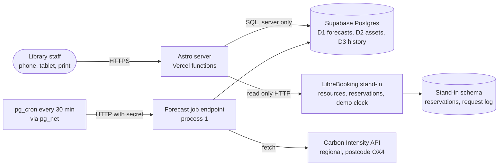

# Technical note – Charging planner

**Project:** Community e-bike library – Charging planner (proof of concept)
**Document:** `docs/technical-note.md`
**Status:** v0.8 (12 November 2026). All questions TQ-01 to TQ-09 answered by Rob and logged as DEC-47 to DEC-53. Branches, databases, the clock for process 1, environment variables and scripts added from DEC-54 to DEC-60; a clock for each reader on the public demo (DEC-61). Anything still marked **(proposed)** was accepted with TQ-06 and can be changed by Claude Code only with Rob's agreement
**Owner:** Rob
**Related:** `docs/prd.md` v0.8 (CON-01 to CON-07, NFR-01 to NFR-20, section 7), `docs/analysis/data-dictionary.md` v0.6, `docs/analysis/normalisation.md` v0.3 and `diagrams/lds/logical-data-structure.mmd`, `docs/analysis/dfds.md` v0.9, `docs/analysis/decision-log.md` v1.5, `docs/ui-spec.md` v0.2, `brand/brand-identity.md` v0.4 and `brand/tokens.css`, `docs/crp-script.md` v1.3 and `test-data/`, `docs/article/measurement-plan.md` v0.9, `CLAUDE.md` and `src/planner/CLAUDE.md` (project copies `claude/CLAUDE.md` and `claude/CLAUDE-planner.md`)

> **Fictional example.** Greener Miles and its data are invented. This note is real: it's how the proof of concept will be built.

---

## 1. Purpose

The PRD says what the charging planner must do and leaves technology out (CON-05). This note says how it's built: the stack, how the parts fit, the rules Claude Code must follow, and the technical requirements the PRD doesn't cover. It closes the "technical note" action left open by DEC-26.

Read this with the PRD. Where this note and the PRD disagree, the PRD wins and this note is corrected.

---

## 2. What we have and what we don't

### 2.1 Available

| Area | What we use | Notes |
|------|-------------|-------|
| Framework | **Astro 6 or later** (DEC-56), server output for planner pages only | Rob's site is an Astro blog template; the planner uses Astro but not the blog's layouts or styles (section 3). The site is upgraded to the latest Astro major version, 6 or later, on `main` before any route starts (DEC-56). Astro 6 and later need Node 22.12 or higher, locally and in Vercel's project settings |
| Language | **TypeScript**, strict mode **(proposed)** | |
| Source control | **GitHub** | Commits use Rob's GitHub noreply address, never a personal email |
| Hosting | **Vercel**, with the `@astrojs/vercel` adapter | HTTPS on every deployment, which REQ-17 needs (section 6.4) |
| Database | **Supabase** (Postgres) | Accessed only from the server (section 6.2). Which project each route uses: section 7 (DEC-58) |
| Scheduling | **Supabase pg_cron**, with **pg_net** for the HTTP call | pg_cron only schedules; pg_net lets the scheduled job call the forecast endpoint. Both are Supabase extensions, switched on in the project's dashboard. Vercel's free (Hobby) plan only runs cron jobs once a day, so it can't run process 1 every 30 minutes. pg_cron is available on every Supabase plan (DEC-48). How it runs in development: section 7 (DEC-60) |
| Design | **AdminLTE 4** (Bootstrap 5.3, MIT licence, no jQuery), themed with `brand/tokens.css`; `brand/brand-identity.md`; Lucide icons | Chosen by Rob as the component base. Theming and the patterns to use are in the UI spec |
| Fonts | Lexend, Atkinson Hyperlegible, IBM Plex Mono, through **Astro's Fonts API** with Google as the provider (DEC-51) | Astro downloads the fonts at build time and serves them from the site, so browsers make no request to Google and the offline plan keeps its fonts. Configured in `astro.config` with the CSS variable names in `tokens.css` |
| Local machine | Windows, project folder `C:\Users\User\Documents\` | See section 3 for which folder |

### 2.2 Not available, and what we do instead

| Not available | Instead |
|---------------|---------|
| The real LibreBooking, or its API details (A-05 outstanding) | A LibreBooking stand-in, built as part of the demo set-up (section 5). Real API details are confirmed by Lewis before go-live (DEC-27, RSK-01) |
| A login or identity provider | None, by design (NFR-05). The picked name is stored on the device (section 6.3) |
| Paid Vercel features (frequent cron, production password protection) | pg_cron for the forecast job; a demo mode switch for the public site (section 7) |
| Docker on the Windows machine (confirmed not installed) | A hosted Supabase project for development and the CRP, not the local Supabase stack (TQ-02) |
| Smart plugs, battery telemetry, charge levels | Out of scope (PRD §1.5) |
| Email, SMS or push notifications | Not needed; nothing in the PRD sends messages |
| File storage | Not needed; attachments are out of scope |

### 2.3 Libraries

Claude Code doesn't add a dependency that isn't listed here without asking Rob first.

| Need | Library **(proposed)** |
|------|-------------------------|
| Supabase access | `@supabase/supabase-js` (server only) |
| Dates and time zones | `date-fns` with `@date-fns/tz`. No other date library |
| Input validation | `zod`, with schemas built from the data dictionary formats |
| Component base | `admin-lte@4` and the Bootstrap 5.3 it depends on, compiled from Sass so brand values replace Bootstrap's defaults. Bootstrap's JavaScript only where a component needs it. AdminLTE's demo plugins (charts, data tables, date pickers) aren't added |
| Sass | `sass`, to compile the themed Bootstrap and AdminLTE |
| Icons | Lucide SVGs, copied inline from `design/reference.html` (not Bootstrap Icons, which AdminLTE's demos use) |
| Unit tests | Vitest |
| Browser tests | Playwright, with `@axe-core/playwright` for accessibility |
| Database migrations | Supabase CLI (`supabase migration`, `supabase db push`) |

No client-side UI framework (React, Vue, Svelte). Pages are server-rendered Astro, forms post to the server, and small scripts handle the few things that must run in the browser (section 6.5).

---

## 3. Where the planner lives

**Decided (TQ-01):** inside the personal site's Astro project, `C:\Users\User\Documents\rob-cockerell.me.uk`, in the same GitHub repository and Vercel project.

To keep the blog safe and the planner looking like Greener Miles, not like the blog:

- **Its own route prefix**, `/demos/charging-planner/` (DEC-47), for every planner page, and `/demos/charging-planner/stand-in/` for the demo set-up (section 5). API endpoints sit under the same prefix.
- **The blog stays static.** The site keeps its static output; only planner pages and endpoints opt out of pre-rendering (`export const prerender = false`) and run as Vercel functions. Blog pages don't change.
- **Its own layout.** Planner pages use a planner layout that imports the themed AdminLTE CSS and `tokens.css`. It never imports the blog's layouts, components or global CSS, and blog pages never import the planner's CSS.
- **Its own source folders** (DEC-60): `src/pages/demos/charging-planner/`, `src/planner/` for its components, modules, styles and unit tests (beside the module they test), `src/planner/standin/` for the test equipment, `supabase/` for migrations, and `e2e/planner/` for browser tests. Claude Code doesn't change files outside these, apart from `astro.config.*`, Vercel configuration, `package.json` and its lock file, `playwright.config.ts`, `vitest.config.ts`, `.env.example` and `.gitignore`, without asking.
- **Its own environment variables**, prefixed `GM_` (section 7.1), so they can't be confused with anything the blog uses.
- **Site rules still apply.** The planner pages carry no personal email address, and commits use the GitHub noreply address.

### 3.1 Branches and CLAUDE.md files

The measurement plan compares three build routes, each on its own branch of this repository (DEC-47, DEC-55):

| Branch | From | Holds |
|--------|------|-------|
| `main` | – | The blog on Astro 6 or later (DEC-56), the root `CLAUDE.md` with the site rules only, and `.claude/settings.json` with auto memory off (DEC-57). This is the **starting commit** for every route |
| `t1-test-equipment` | The starting commit | The analysis documents (`docs/`, `diagrams/`), `design/`, `brand/`, `test-data/`, `src/planner/CLAUDE.md` and the import line `@src/planner/CLAUDE.md` in the root `CLAUDE.md` (DEC-54), then the test equipment (section 5) |
| `route-a` | The tip of `t1-test-equipment` | Route A's build |
| Route B and C branches | The starting commit | Their builds. They never have the documents, the planner CLAUDE.md or the test equipment |

Claude Code loads a `CLAUDE.md` in a subfolder only when it opens files in that folder, which is why the root file imports the planner guide on the T1 and route A branches.

---

## 4. Architecture

### 4.1 Mapping the DFD to the build

| DFD | Built as |
|-----|----------|
| Process 1 Fetch forecast | A server endpoint called by pg_cron every 30 minutes, protected by a shared secret. It fetches the regional forecast for OX4 and upserts periods into D1 by period start (BR-08, DEC-13). It uses the system clock and skips the scenario dates (section 4.2, DEC-59) |
| Process 2 Build day plan | A pure TypeScript module that takes resources, reservations, forecasts, faults and "now", and returns the day plan. No database or network calls inside it, so BR-01 to BR-05, BR-09, BR-10 and BR-12 can be unit tested directly |
| Processes 3.1 to 3.4 Fleet records | Server-rendered pages and form handlers. Validation follows the data dictionary formats |
| D1, D2, D3 | Postgres tables derived from the logical data structure and normalisation (3NF). Claude Code proposes the schema as a migration for Rob to review before building screens |
| LibreBooking | Reached through one client module whose base URL is an environment variable. Swapping the stand-in for the real API is a configuration change plus field mapping |

### 4.2 Rules Claude Code follows

- **One clock.** All code gets "now" from a single `clock` module. Its `now()` is business time: in demo mode it reads the stand-in's demo clock; otherwise the system clock. Nothing else calls `new Date()` or `Date.now()` for business time. Recorded at, Last updated at and Fitted from all use `now()` (AC-07.1). The only exception is `systemNow()`, used by process 1 to choose which periods to fetch from the live API and to stamp Retrieved at, and by the fixture loader for Retrieved at (DEC-59).
- **Recorded forecasts stay.** Process 1 never overwrites D1 periods on the scenario dates in PRD Appendix A.1; those come only from `test-data/forecasts.csv` (DEC-26, DEC-59).
- **One time zone rule.** Store instants as `timestamptz`. Convert to Europe/London only when building slots or showing times (BR-08). Slot times are built as local times, never by adding 30 minutes to a UTC instant across a day.
- **Read only to LibreBooking.** The client module has no methods that create, change or delete (NFR-04).
- **Append only history.** Fittings and entries are inserted, never updated or deleted, except clearing a fault (BR-07).
- **No status column for bikes.** Bike state is always worked out by process 2 (DEC-01).
- **Copy comes from the PRD and brand identity.** State names, empty values and messages use the exact wording in the PRD and data dictionary.

---

## 5. Demo set-up: stand-in, demo clock and fixtures

These are test equipment, not part of the product (DEC-26, DEC-29). They live under their own route prefix, their own source folder (`src/planner/standin/`) and their own database schema (`standin`), so they can be removed or replaced without touching the planner. They're built as shared step T1 on the `t1-test-equipment` branch (DEC-46, DEC-55).

| Part | What it does |
|------|--------------|
| Stand-in API | Two read endpoints, resources with status and reservations with start, end and checked-in time, shaped like LibreBooking's web services as far as they're known (PRD §7.1). Includes earlier reservations still running or not checked in (DEC-24) |
| Request log | Logs every request with method, path and time, so NFR-04 can be checked after S1 to S14 |
| Demo clock | Holds the demo date and time. Can be set, or left running from a set start |
| Tester console | A plain page for the CRP facilitator: set the clock, change a resource's status, add a check-in, load a scenario's starting state, reset everything. Protected by `GM_STANDIN_CONSOLE_KEY` |
| Fixtures | Loaded from `test-data/*.csv`. Reset restores the starting data for D2, D3, the stand-in and the recorded forecasts in D1 (pilot readiness item 5). T1 builds loading and resetting for the stand-in and makes the forecasts file ready; route A adds loading for D1 to D3 once its schema is approved, and counts that work in its own totals (DEC-55) |
| Recorded forecasts | The Appendix A.5 forecasts, loaded into D1 for the scenario dates. On any other date, process 1 uses the live API (DEC-59) |

The tester console isn't linked from the planner and isn't available in public demo mode (section 7). The stand-in's endpoints and settings are written up in `src/planner/standin/README.md`, so any route's build can be pointed at it at the pilot.

---

## 6. Technical decisions

### 6.1 Rendering

The site stays static and uses the `@astrojs/vercel` adapter; every planner page and endpoint sets `prerender = false` and is rendered on request, because the day plan depends on "now" and on live reservations. Forms use standard HTML posts with a redirect after a successful save, so they work with the minimum of JavaScript and the back button behaves.

### 6.2 Database access and security

- The Supabase service key is used only on the server and held in environment variables. Nothing prefixed `PUBLIC_` holds a secret.
- Row level security is switched on for every table with no policies for the anonymous role, so the public key can read or write nothing even if it leaks.
- Astro escapes output by default. `set:html` is never used with stored data.
- Astro's origin check for form posts stays on, which guards against cross-site form posts.

### 6.3 The picked name

The name is stored in a long-lived cookie, so server-rendered forms can stamp it without asking again (AC-10.2). It's read on the server and written into Recorded by, Last updated by and Cleared by. It isn't a login and isn't verified (NFR-05, ASM-12). Per DEC-37 the name is typed once, not chosen from a list.

### 6.4 Offline day plan (REQ-17, Could)

A small service worker caches the last day plan page and shows it with a notice and its load time when the network is down. Service workers only run on HTTPS or `localhost`. A phone opening the planner over the depot network at a plain `http://` address won't get one. For the CRP on phones, use a Vercel preview deployment.

### 6.5 JavaScript in the browser

Kept to:

- the service worker (REQ-17)
- the print button (REQ-12)
- defaulting date-time fields to the demo clock's "now"
- the quarantine warning, which also works without JavaScript as a confirmation page (REQ-11)

### 6.6 Responsive layout and print

One day plan page, two layouts: the phone timeline (REQ-04) below a breakpoint, and the grid (REQ-12) above it. The grid has a print stylesheet for A4 landscape.

AdminLTE's app shell is built for desktop admin screens. The planner uses its header and off-canvas menu on phones, keeps the main content full width, and leaves out the dashboard widgets. The UI spec says which AdminLTE and Bootstrap components are used and how.

### 6.7 Dark theme

`tokens.css` follows the device's dark mode setting (DEC-34). `design/planner-theme.scss` sets Bootstrap's `$color-mode-type: media-query`, so Bootstrap and AdminLTE switch on the same `prefers-color-scheme` media query as the tokens, with no script and no `data-bs-theme` attribute. There's no theme switch on screen. Detail in the UI spec §10.

### 6.8 Concurrent edits **(proposed)**

Last write wins for bikes, batteries and battery types; the change stamp shows who saved last. Fittings and entries are append only, so two people recording at once can't overwrite each other. Battery location is worked out from the latest fitting (BR-02), so it stays consistent.

### 6.9 Errors

- **Validation:** the form is shown again with the user's input kept, an error summary at the top and a message by each field (AC-06.2, AC-09.6). Detail is in the UI spec.
- **Save failure** (database unreachable): the form is shown again with input kept and a plain message that nothing was saved.
- **A source down:** as PRD §7.3.
- Errors are logged on the server with enough detail to debug; staff never see a stack trace.

---

## 7. Environments

| Environment | Where | Purpose | Demo mode |
|-------------|-------|---------|-----------|
| Local | `astro dev` on Rob's machine, development Supabase project | Building | On |
| CRP | Vercel preview deployment, behind Vercel's deployment protection, with access for the CRP participants set up before the session | Conference room pilot on real phones and a tablet, over HTTPS. The protection is the access control NFR-13 allows | On, with tester console |
| Public demo | Vercel production, linked from the article | Readers try the planner | On, no changes saved |

**Public demo (decided, TQ-04).** NFR-13 says the tool must only be reachable from the depot network, because there's no login. A public demo on the open internet breaks that, so the public site runs in a demo mode where nothing is saved. Readers can open every screen, fill in every form and see validation messages. Choosing save shows "This is a demo, so changes aren't saved" and leaves the records unchanged. Readers can move the demo clock between the scenario dates, but only for themselves: in public demo mode the clock module's `now()` reads the reader's chosen date and time from a cookie, starting at Tue 16 June 2026 07:00, and nothing a reader does changes the stand-in's shared demo clock (DEC-61). The tester console is switched off. A single environment variable, `GM_PUBLIC_DEMO`, turns this mode on. This keeps NFR-05 (no login) without leaving the records open to anyone.

**Databases (DEC-58).** T1 and route A share the hosted development Supabase project: the stand-in in the `standin` schema, D1 to D3 in `public`. The CRP uses the same project. If a route B or C build asks for a hosted database, it gets a new project of its own, never route A's. If the free plan's project limit is reached, pause the project of a route that's finished.

**Test equipment for routes B and C at the pilot (DEC-29).** The stand-in runs from the `t1-test-equipment` branch: its Vercel preview deployment, or `astro dev` on Rob's machine. Routes B and C are pointed at it using `src/planner/standin/README.md`; record the configuration each needs (measurement plan §6.1).

**Process 1 (DEC-48, DEC-60).** pg_cron, using pg_net for the HTTP request, calls the forecast job endpoint on the production deployment once the planner is deployed there, sending `GM_FORECAST_JOB_SECRET`; the secret is held in the Supabase project as well as in Vercel. pg_cron can't call preview deployments, which are behind deployment protection, or Rob's machine. In development, and until the planner is on production, run process 1 with `npm run job:forecast`.

**Supabase free plan.** A free Supabase project pauses after about a week with no activity. The pg_cron job keeps it active while it runs; if the project is paused, the public demo needs it restored before showing.

### 7.1 Environment variables (DEC-60)

Declared in Astro's environment schema (`astro:env`) in the server context, with secrets set to `access: "secret"`. Names, without values, go in `.env.example`; `.env` files aren't committed. The Supabase CLI's own login stays outside `GM_`. NFR-20's test searches the files sent to the browser for every secret below.

| Name | Holds | Secret |
|------|-------|--------|
| `GM_SUPABASE_URL` | Supabase project URL | No (server only) |
| `GM_SUPABASE_SERVICE_KEY` | Service role key | **Yes** |
| `GM_LIBREBOOKING_URL` | Base URL of the stand-in, later the real API | No |
| `GM_FORECAST_JOB_SECRET` | Shared secret pg_cron sends to the forecast job | **Yes** |
| `GM_STANDIN_CONSOLE_KEY` | Tester console key | **Yes** |
| `GM_DEMO_MODE` | `true`: the clock's `now()` reads the demo clock | No |
| `GM_PUBLIC_DEMO` | `true`: nothing saved, console off, demo notice shown | No |
| `GM_HANDBOOK_URL` | Charging rules link (AC-16.1, AC-16.2) | No |

### 7.2 npm scripts (DEC-60)

| Script | Runs |
|--------|------|
| `npm run dev` / `npm run build` | The site's existing Astro scripts |
| `npm run test:unit` | `vitest run` |
| `npm run test:e2e` | `playwright test` (the config starts the dev server) |
| `npm test` | Unit tests, then browser tests |
| `npm run theme` | Compile `design/planner-theme.scss` to `design/planner.css` for the reference page. The output isn't committed |
| `npm run db:new -- <name>` | `supabase migration new <name>` |
| `npm run db:push` | `supabase db push`, only after Rob approves the migration |
| `npm run demo:reset -- <R0\|R1\|R2\|R3\|R3a>` | Reset as CRP script §3.4, using the same code as the tester console |
| `npm run job:forecast` | Run process 1 once against the local server |

---

## 8. Additions to the PRD's non-functional requirements

Agreed by Rob (TQ-07, DEC-52) and copied into PRD v0.8 §5.3, which is the master. The table is kept here for reference.

| ID | Requirement | Measure and test |
|----|-------------|------------------|
| NFR-14 | One clock for all business time | **Test:** with the demo clock set to 08:05 on Tue 16 June 2026, record a swap; Recorded at and Fitted from read 08:05 that day. A code search finds no other use of the system clock for business time |
| NFR-15 | Phones get the planner over HTTPS | **Test:** the CRP deployment's address starts `https://`; REQ-17's service worker registers on a phone |
| NFR-16 | Concurrent edits don't lose history | **Test:** two devices record a swap on the same bike within a minute; both fittings are saved and the bike shows the later one |
| NFR-17 | Stored text can't run as code; forms can't be posted from another site | **Test:** a fault description containing `<script>` is shown as text; a form post from another origin is rejected |
| NFR-18 | Every Must acceptance criterion has an automated test | **Test:** the test report lists a passing test named for each AC-01.x to AC-11.x; Playwright runs S1 to S14 at the NFR-02 sizes, with an axe check on the day plan, an asset record and the swap screen (NFR-03) |
| NFR-19 | A failed save loses nothing the user typed | **Test:** with the database unreachable, submit a fault report; the form returns with the description kept and a message that nothing was saved |
| NFR-20 | Secrets stay on the server | **Test:** the built client files contain no Supabase service key, no forecast job secret and no stand-in console key |

---

## 9. Questions for Rob

| ID | Question | Proposal | Answer |
|----|----------|----------|--------|
| TQ-01 | Separate repository and Vercel project, or inside the blog project? | Separate | **Inside the blog project** (Rob, 12 November 2026). Section 3 rewritten |
| TQ-02 | Hosted Supabase project for development, or the local Supabase stack (needs Docker)? | Hosted | **Hosted**, since Docker isn't installed |
| TQ-03 | Is Docker Desktop installed on the Windows machine? | Assumed not | **Not installed** |
| TQ-04 | Public demo with no changes saved, as section 7? | Yes | **Yes** |
| TQ-05 | Self-host the fonts instead of loading them from Google Fonts (a change to brand identity §5)? | Astro Fonts API with Google as the provider | **Yes** (DEC-51) |
| TQ-06 | Accept the library list in section 2.3, including AdminLTE 4? | Yes | **Yes** (DEC-50) |
| TQ-07 | Accept NFR-14 to NFR-20, and confirm or drop the candidates NFR-08 to NFR-13? | Accept; confirm NFR-08 to NFR-11 and NFR-13 for the pilot, NFR-12 at go-live | **Yes** (DEC-52) |
| TQ-08 | The fictional depot is in Cowley, Oxford. Is that fine on the public site? | Rob to decide | **Fine** (DEC-53) |
| TQ-09 | Route prefix `/demos/charging-planner/`? | Yes | **Yes** (DEC-47) |

---

## 10. Still to write

- ~~UI spec~~: done as `docs/ui-spec.md`, with `design/planner-theme.scss`, `design/planner-components.scss` and `design/reference.html`.
- ~~CLAUDE.md~~: done as the root `CLAUDE.md` (site rules, all routes) and `src/planner/CLAUDE.md` (the planner guide, T1 and route A), DEC-54. Project copies `claude/CLAUDE.md` and `claude/CLAUDE-planner.md`.

---

## Change history

| Version | Date | Change |
|---------|------|--------|
| 0.1 | 12 November 2026 | First draft from Rob's stack (Astro, GitHub, Vercel, Supabase) and PRD v0.7 |
| 0.2 | 12 November 2026 | Rob's answers: inside the blog project (section 3 rewritten), hosted Supabase, no Docker, public demo saves nothing, Cowley fine. AdminLTE 4 added as the component base (sections 2, 6.6, 6.7). TQ-09 added |
| 0.3 | 12 November 2026 | TQ-05 to TQ-07 and TQ-09 answered: Astro Fonts API with Google as the provider, library list accepted, NFRs agreed (now in PRD v0.8 §5.3), route prefix confirmed. CRP deployment protection added to section 7. Decisions logged as DEC-47 to DEC-53 |
| 0.4 | 12 November 2026 | Dark mode switches by media query, not AdminLTE's script (§6.7); UI spec and design files written (§10) |
| 0.5 | 12 November 2026 | From writing the CLAUDE.md files (DEC-54 to DEC-60): branches and CLAUDE.md files (§3.1); test folders (§3); process 1's clock and the scenario dates (§4.1, §4.2); T1 and route A's split of the fixture loaders (§5); databases, test equipment for routes B and C, and how process 1 runs (§7); environment variables (§7.1) and npm scripts (§7.2). Astro 6 named, with the upgrade on `main` (DEC-56) |
| 0.6 | 12 November 2026 | Public demo: each reader's demo date and time is held in a cookie, so readers don't move the shared demo clock (§7, DEC-61) |
| 0.7 | 12 November 2026 | Astro 6 or later, with Node 22.12 or higher (§2.1, §3.1, DEC-56) |
| 0.8 | 12 November 2026 | pg_net added alongside pg_cron for the forecast job's HTTP call (§2.1, §4, §7). Project copy of the repository file map: `claude/repo-setup.md` |
